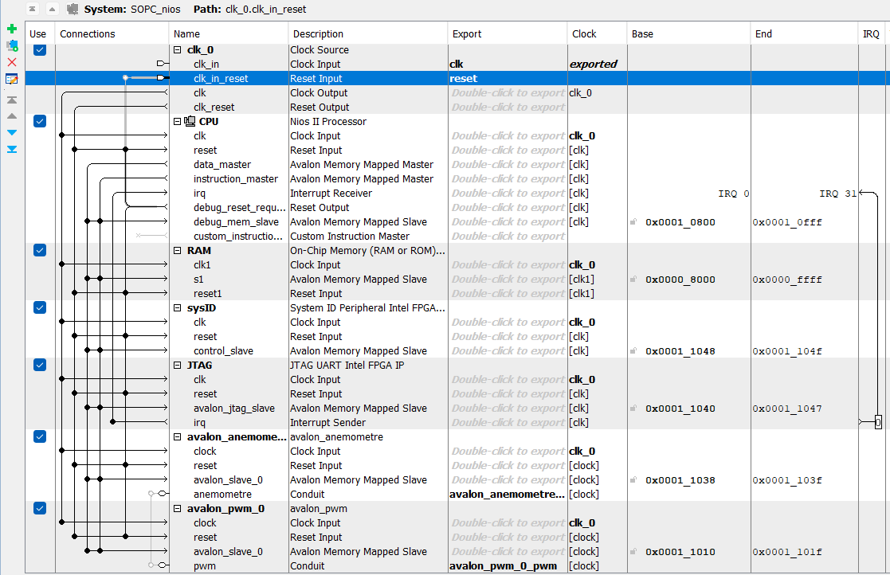
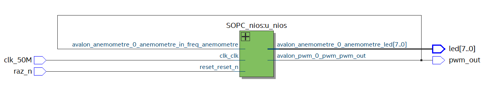
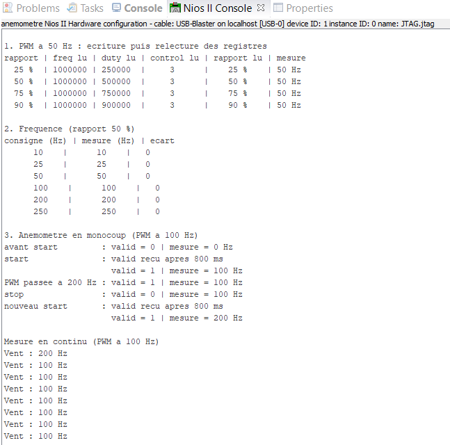
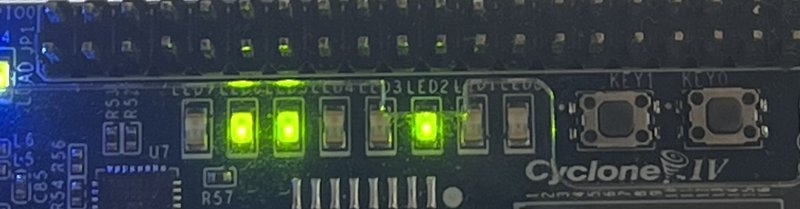
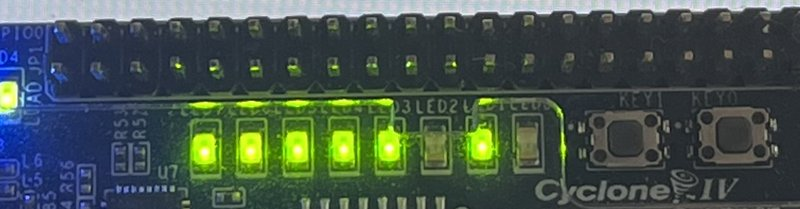

# BE 2026 — SOPC Nios II : PWM + anémomètre

**Alexandre Aragones et Mathieu Florens** — M2 SME, groupe B2 — DE0-Nano (Cyclone IV E), Quartus 18.1 Lite

## Objectif

Valider un SOPC Nios II intégrant le PWM et la fonction simple « anémomètre ». Faute
d'oscilloscope, le PWM produit par le SOPC est renvoyé sur l'entrée de l'anémomètre : le
Nios impose une fréquence et vérifie que l'anémomètre mesure la même.

## Démarche

1. **Fonction simple** `gestion_anemometre` : machine de Moore à 4 états qui compte les
   fronts de l'entrée pendant 1 s, ce qui donne directement la fréquence en Hz sur 8 bits.
2. **Interfaces Avalon** : chaque entité est enveloppée dans un composant `avalon_*` dont
   les entrées deviennent des registres, avec un process d'écriture et un de lecture
   (méthode du document COMPOSANT-NIOS). Le bit `valid` de l'anémomètre est mémorisé
   jusqu'à sa lecture, sinon il ne dure que 20 ns en mode continu.

   | Composant | Adresse | Registre | Rôle |
   |---|---|---|---|
   | `avalon_pwm` | base + 0 | `freq` | période en coups d'horloge : f = 50 MHz / `freq` |
   | | base + 4 | `duty` | durée à l'état haut en coups d'horloge |
   | | base + 8 | `control` | bit 0 `raz_n`, bit 1 `enable` |
   | `avalon_anemometre` | base + 0 | `config` | bit 0 `raz_n`, bit 1 `continu`, bit 2 `start_stop` |
   | | base + 4 | `code` | bits 7..0 mesure en Hz, bit 9 `valid` |

3. **Platform Designer** : Nios II/e, RAM 32 Ko, System ID, JTAG UART et les deux composants.

   

4. **Haut niveau** `SOPC.vhd` : relie la sortie du PWM à l'entrée de l'anémomètre (vue RTL).

   

5. **Logiciel** `main.c` (Eclipse), en quatre tests : écriture puis relecture des registres
   du PWM pour quatre rapports cycliques, balayage en fréquence, mode monocoup de
   l'anémomètre, puis mesure en continu.

## Résultats

**En simulation**, la fonction anémomètre a été validée sous ModelSim (captures dans
[`gestion_anemometre/`](gestion_anemometre/)). La chaîne PWM → anémomètre avec ses
interfaces Avalon (`SOPC/tb_chaine_sopc.vht`) mesure exactement la consigne de 10 à 250 Hz,
et 0 quand le PWM est arrêté.

**Sur la carte**, console Eclipse :



1. **PWM** : pour les quatre rapports cycliques (25, 50, 75 et 90 %), les registres relus
   sont ceux qui ont été écrits, et l'anémomètre mesure toujours 50 Hz. Sans oscilloscope,
   le rapport cyclique n'est pas mesuré : il est vérifié par la relecture du registre `duty`.
2. **Fréquence** : la mesure égale la consigne de 10 à 250 Hz.
3. **Monocoup** : `valid` vaut 0 avant le start et passe à 1 après la fenêtre de mesure.
   La mesure ne change plus ensuite (100 Hz alors que le PWM est passé à 200 Hz), `valid`
   revient à 0 au stop, et un nouveau start donne 200 Hz. Le temps affiché (800 ms) est
   approximatif : `usleep` est une boucle d'attente logicielle, le SOPC n'ayant pas de
   timer. La fenêtre de mesure dure exactement 1 s (50 000 000 coups d'horloge).
4. **Continu** : la première ligne reprend la dernière mesure du monocoup, puis la mesure
   suit le PWM à 100 Hz.

Les LED affichent la mesure en binaire, LED7 à gauche et LED0 à droite :

| 100 Hz = `0110 0100` | 250 Hz = `1111 1010` |
|---|---|
|  |  |

L'écart est nul parce que le PWM et la fenêtre d'une seconde partagent la même horloge à
50 MHz. Avec le vrai capteur, asynchrone, la méthode garde une erreur de ±1 Hz (1 LSB).

## Fichiers

```
BE_2026/
├── gestion_anemometre/   fonction simple et son interface Avalon
├── pwm/                  PWM et son interface Avalon
├── SOPC/                 projet Quartus, système Platform Designer, SOPC.vhd, main.c, captures
└── pwm_moteur/           première ébauche du PWM, non utilisée dans le SOPC
```
