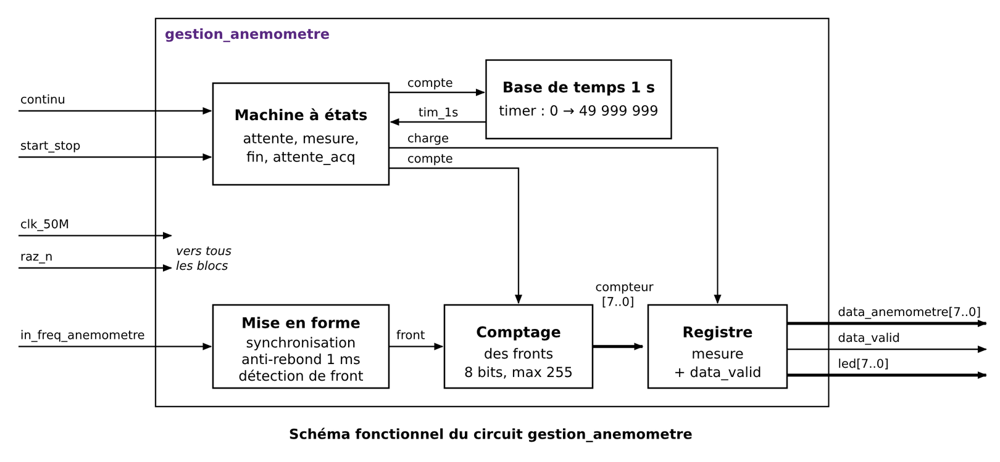
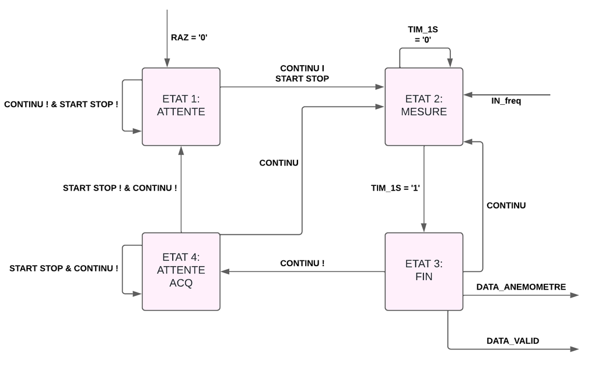
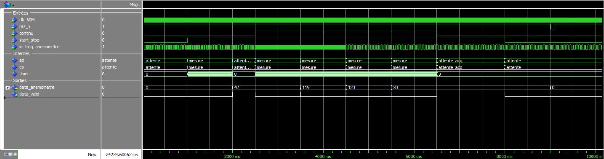
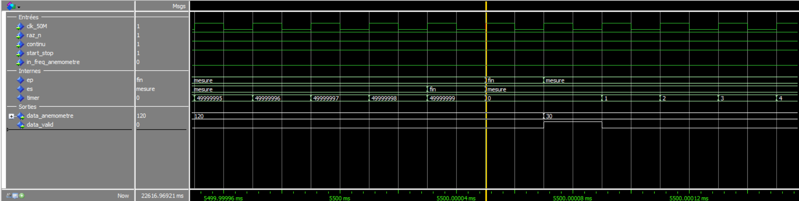

# Fonction simple : gestion de l'anémomètre — analyse fonctionnelle

## Rôle

L'anémomètre délivre un signal dont la fréquence, de 0 à 250 Hz, est proportionnelle à la
vitesse du vent. Le circuit compte les fronts montants de ce signal pendant exactement 1 s :
le nombre obtenu est la fréquence en Hz, qui tient sur 8 bits.

| Signal | Sens | Rôle |
|---|---|---|
| `clk_50M` | entrée | horloge 50 MHz |
| `raz_n` | entrée | remise à zéro, active à 0 |
| `in_freq_anemometre` | entrée | signal de l'anémomètre, 0 à 250 Hz |
| `continu` | entrée | 1 : une mesure par seconde ; 0 : mode monocoup |
| `start_stop` | entrée | en monocoup, 1 lance une mesure, 0 l'acquitte |
| `data_anemometre[7..0]` | sortie | fréquence mesurée en Hz |
| `data_valid` | sortie | 1 quand une nouvelle mesure est disponible |
| `led[7..0]` | sortie | copie de `data_anemometre` pour la vérification sur carte |

## Fonctions

Le circuit est constitué de cinq fonctions :

- **Mise en forme du signal d'entrée**
  - synchronisation sur l'horloge par deux bascules (`sync1`, `sync2`) : le signal vient de
    l'extérieur et n'est pas synchrone de `clk_50M` ;
  - filtre anti-rebond : la sortie `debounced` ne change que si l'entrée reste stable pendant
    `max_debounce` = 50 000 coups d'horloge (1 ms). Le capteur peut être un contact qui
    rebondit. Conséquence : la fréquence mesurable est limitée à 500 Hz, au-dessus des 250 Hz
    demandés ;
  - détection de front montant : `front` vaut 1 pendant un coup d'horloge quand `debounced`
    passe de 0 à 1.
- **Base de temps 1 s** : `timer` compte de 0 à 49 999 999 pendant la mesure ; `tim_1s` vaut 1
  sur le dernier coup et termine la fenêtre.
- **Comptage des fronts** : `compteur` (8 bits) augmente à chaque `front` pendant la mesure,
  sature à 255 et revient à 0 hors mesure.
- **Registre de sortie** : à la fin de la fenêtre, `registre` reçoit `compteur` et garde la
  valeur jusqu'à la mesure suivante. `data_valid` passe à 1 au même moment ; il revient à 0
  au début de la mesure suivante (mode continu) ou quand `start_stop` revient à 0 (monocoup).
- **Machine à états** : elle séquence les autres fonctions avec deux commandes, `compte`
  (fenêtre de mesure en cours) et `charge` (chargement du registre).

Dans `gestion_anemometre.vhd`, les quatre premières fonctions et l'état présent sont dans la
partie séquentielle, le calcul de l'état suivant dans la partie combinatoire.

## Signaux internes

| Signal | Fonction | Rôle |
|---|---|---|
| `sync1`, `sync2` | mise en forme | `in_freq_anemometre` recopié sur deux fronts d'horloge successifs (synchronisation) |
| `debounce_cnt` | mise en forme | durée, en coups d'horloge, pendant laquelle `sync2` diffère de `debounced` |
| `debounced` | mise en forme | signal filtré : prend la valeur de `sync2` après 50 000 coups stables (1 ms) |
| `avant` | mise en forme | valeur de `debounced` au coup d'horloge précédent |
| `front` | mise en forme | 1 pendant un coup d'horloge à chaque front montant de `debounced` |
| `timer` | base de temps | coups d'horloge écoulés dans la fenêtre, de 0 à 49 999 999 |
| `tim_1s` | base de temps | 1 sur le dernier coup de la fenêtre d'1 s |
| `compteur` | comptage | nombre de fronts dans la fenêtre en cours, saturé à 255 |
| `registre` | registre de sortie | dernière mesure complète, recopiée sur `data_anemometre` et `led` |
| `valid` | registre de sortie | recopié sur `data_valid` |
| `ep`, `es` | machine à états | état présent, état suivant |
| `compte` | machine à états | 1 dans l'état `mesure` : active `timer` et `compteur` |
| `charge` | machine à états | 1 dans l'état `fin` : charge `registre` et met `valid` à 1 |

## Machine à états

Notation du diagramme : `I` = ou, `&` = et, `!` = non.

| État | Rôle | Passe à |
|---|---|---|
| `attente` | repos, rien n'est compté | `mesure` si `continu` = 1 ou `start_stop` = 1 |
| `mesure` | fenêtre d'1 s : timer et compteur actifs (`compte` = 1) | `fin` quand `tim_1s` = 1 |
| `fin` | un seul coup d'horloge : chargement du registre, `data_valid` à 1 (`charge` = 1) | `mesure` si `continu` = 1, sinon `attente_acq` |
| `attente_acq` | monocoup : la mesure est gardée, `data_valid` reste à 1 | `mesure` si `continu` = 1, `attente` si `start_stop` = 0 |

En continu, la boucle `mesure` → `fin` → `mesure` donne une nouvelle valeur chaque seconde.
En monocoup, une seule mesure est faite par appui sur start_stop.

## Précision

Le signal du capteur n'est pas synchrone de la fenêtre d'1 s : selon la position des fronts
par rapport au début de la fenêtre, on compte un front de plus ou de moins. L'erreur est donc
de ±1 Hz, soit 1 LSB.

## Validation en simulation (ModelSim)

Le testbench `tb_gestion_anemometre.vht` simule 10 s en temps réel avec ce scénario :

| Temps | Action | Résultat attendu |
|---|---|---|
| 0 s | repos, vent à 47 Hz | rien n'est mesuré |
| 1 s | `start_stop` = 1 (monocoup) | à 2 s : 47, `data_valid` = 1, mesure gardée |
| 2,5 s | `continu` = 1, vent à 120 Hz | une mesure par seconde |
| 4,5 s | vent à 30 Hz | la mesure suit |
| 6,5 s | `continu` = 0 | la mesure est gardée, `data_valid` = 1 |
| 8 s | `start_stop` = 0 | `data_valid` revient à 0 |
| 9 s | `raz_n` = 0 | la mesure revient à 0 |

On retrouve 47 en monocoup, puis 119, 120 et 30 en continu. La première fenêtre en continu
commence pendant le passage de 47 à 120 Hz et compte donc un front de moins (119).

Zoom sur la fin d'une fenêtre en continu : `timer` atteint 49 999 999, l'état passe à `fin`
pendant un seul coup d'horloge, le registre passe de 120 à 30 et `data_valid` ne dure que
20 ns avant que la mesure suivante commence.

## Interface Avalon (`avalon_anemometre.vhd`)

Pour le SOPC, le circuit est enveloppé dans un composant Avalon qui a trois fonctions :

- **Écriture** : le registre `config` reçoit `writedata` quand le Nios écrit à l'adresse 0.
- **Lecture** : l'adresse 0 renvoie `config`, l'adresse 1 renvoie `code`.
- **Mémorisation de `data_valid`** : en continu, `data_valid` ne dure que 20 ns, trop peu pour
  que le Nios le voie en lisant le registre. `valid_memo` passe à 1 avec `data_valid` et
  revient à 0 quand le Nios lit `code`.

Signaux internes de l'interface : `config` (registre écrit par le Nios), `raz_n`, `continu`
et `start_stop` (ses bits, envoyés au circuit), `ecriture` et `lecture` (accès du Nios en
cours), `valid_memo` (`data_valid` mémorisé).

| Registre | Adresse | Bits |
|---|---|---|
| `config` | base + 0 | b0 `raz_n`, b1 `continu`, b2 `start_stop` |
| `code` | base + 4 | b7..b0 `data_anemometre`, b9 `valid` |

La remise à zéro du circuit est active si le bus est en reset ou si le bit `raz_n` de
`config` vaut 0.

La validation sur carte, dans le SOPC, est dans le [compte rendu](../README.md).
