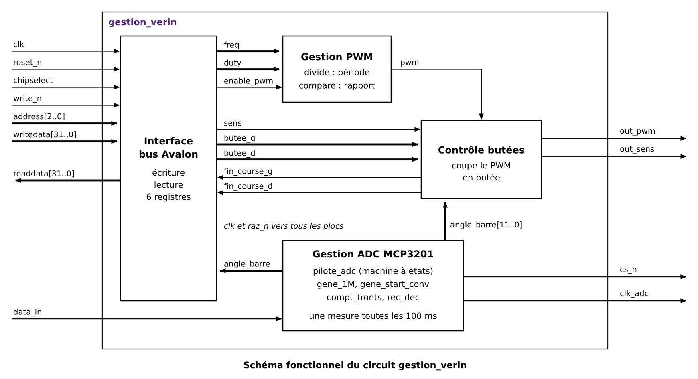

# Fonction complexe : gestion du vérin — analyse fonctionnelle

D'après la spécification des interfaces du pilote de barre franche (T. Perisse) et la carte
d'interface vérin.

## Rôle

Le circuit commande le vérin électrique qui déplace la barre. Il produit le PWM et le sens du
moteur, envoyés au pont en H DRV8835 de la carte d'interface. Il coupe le moteur quand la
barre atteint une butée, et lit la position de la barre (`angle_barre`) sur le convertisseur
MCP3201. Le Nios le pilote par 6 registres Avalon.

| Signal | Sens | Rôle |
|---|---|---|
| `clk` | entrée | horloge 50 MHz |
| `reset_n` | entrée | reset du bus, actif à 0 |
| `chipselect`, `write_n`, `address[2..0]`, `writedata[31..0]` | entrées | bus Avalon |
| `data_in` | entrée | sortie série du MCP3201 |
| `readdata[31..0]` | sortie | bus Avalon |
| `out_pwm` | sortie | PWM du moteur, coupé en butée |
| `out_sens` | sortie | sens de rotation (0 = gauche) |
| `cs_n` | sortie | sélection du MCP3201, active à 0 |
| `clk_adc` | sortie | horloge série du MCP3201 |

| Registre | Adresse | Type | Bits |
|---|---|---|---|
| `freq` | 0 | R/W | b15..b0 : période du PWM, f = 50 MHz / `freq` (2000 → 25 kHz) |
| `duty` | 1 (4) | R/W | b15..b0 : durée à l'état haut (`freq`/2 → 50 %) |
| `butee_g` | 2 (8) | R/W | b15..b0 : butée gauche, 0 à 4095 |
| `butee_d` | 3 (12) | R/W | b15..b0 : butée droite, 0 à 4095 |
| `config` | 4 (16) | R/W | b0 `raz_n`, b1 `enable_pwm`, b2 `sens` |
| | | R | b3 `fin_course_d`, b4 `fin_course_g` |
| `angle_barre` | 5 (20) | R | b11..b0 : position de la barre |

## Fonctions

Le circuit est constitué de quatre fonctions principales.

**Interface avec le bus Avalon**
- écriture : `freq`, `duty`, `butee_g`, `butee_d` et les bits b2..b0 de `config` reçoivent
  `writedata` quand le Nios écrit à leur adresse ;
- lecture : renvoie le registre demandé ; `config` renvoie aussi `fin_course_d` et
  `fin_course_g`, `angle_barre` la dernière conversion.

La remise à zéro des autres fonctions est active si le bus est en reset ou si le bit `raz_n`
de `config` vaut 0, comme pour les composants du SOPC.

**Gestion du PWM** (reprend le PWM validé dans le SOPC)
- `divide` : compteur de 0 à `freq` − 1, qui fixe la période ;
- `compare` : `pwm` vaut 1 tant que le compteur est inférieur à `duty`.
Le PWM ne tourne que si `enable_pwm` = 1.

**Contrôle des butées** (`controle_butees`)
- `fin_course_g` = 1 si `angle_barre` ≤ `butee_g`, `fin_course_d` = 1 si `angle_barre` ≥
  `butee_d` : la gauche correspond aux petites valeurs, comme dans l'exemple du prof
  (`butee_g` = 410, `butee_d` = 1320) ;
- `out_pwm` = 0 si le moteur va vers une butée atteinte (`sens` = 0 et `fin_course_g` = 1, ou
  `sens` = 1 et `fin_course_d` = 1), sinon `out_pwm` = `pwm`. Le moteur peut toujours repartir
  dans l'autre sens ;
- `out_sens` = `sens`.

Les butées valent 0 au démarrage : tant que le Nios ne les a pas écrites, `fin_course_d` = 1
et le moteur ne peut pas aller à droite.

**Gestion du convertisseur MCP3201**
- `gene_1M` : divise 50 MHz par 50, donne un top à 1 MHz qui cadence la machine à états ;
- `gene_start_conv` : donne un top `start_conv` toutes les 100 ms, soit 10 mesures de l'angle
  par seconde ;
- `pilote_adc` : machine à états qui baisse `cs_n`, fabrique `clk_adc`, puis remonte `cs_n` et
  mémorise `angle_barre` ;
- `compt_fronts` : compte les fronts montants de `clk_adc` pour savoir quand la lecture est
  finie ;
- `rec_dec` : registre à décalage qui récupère `data_in` à chaque front montant de `clk_adc`.

## Échange avec le MCP3201

D'après la documentation du MCP3201 : la conversion démarre quand `cs_n` passe à 0. Le
convertisseur change sa sortie sur les fronts descendants de `clk_adc` ; on la lit sur les
fronts montants. L'horloge ne doit pas dépasser 1,6 MHz (alimentation 5 V).

| Front montant de `clk_adc` | `data_in` |
|---|---|
| 1 et 2 | rien d'utile : le MCP3201 échantillonne l'entrée analogique |
| 3 | bit nul (0) |
| 4 à 15 | B11 (poids fort) … B0 |

Après le 15ᵉ front montant, les 12 derniers bits de `rec_dec` forment `angle_barre`.

Choix : `pilote_adc` inverse `clk_adc` à chaque top 1 MHz, donc `clk_adc` = 500 kHz. Une
lecture dure 15 × 2 µs = 30 µs, très court devant les 100 ms entre deux mesures.

Machine à états proposée pour `pilote_adc` :

| État | `cs_n` | `clk_adc` | Rôle | Passe à |
|---|---|---|---|---|
| `repos` | 1 | 0 | attend `start_conv` | `lecture` si `start_conv` = 1 |
| `lecture` | 0 | inversée à chaque top 1 MHz | 15 fronts montants, `rec_dec` décale `data_in` | `fin` après le 15ᵉ front |
| `fin` | 1 | 0 | `angle_barre` ← 12 derniers bits de `rec_dec` | `repos` |

## Validation prévue en simulation

1. **PWM et butées** : testbench qui fixe `freq`, `duty`, `sens`, les butées et `angle_barre`,
   et vérifie que `out_pwm` est coupé seulement vers la butée atteinte.
2. **MCP3201** : le testbench imite le convertisseur (il renvoie une valeur connue, bit par
   bit, sur les fronts descendants de `clk_adc`) ; on vérifie `cs_n`, `clk_adc` et
   `angle_barre`.
3. **Interface Avalon** : écriture puis relecture des 6 registres, comme pour le SOPC.
4. **Circuit complet**, puis intégration dans le SOPC et essai sur la carte d'interface vérin.
