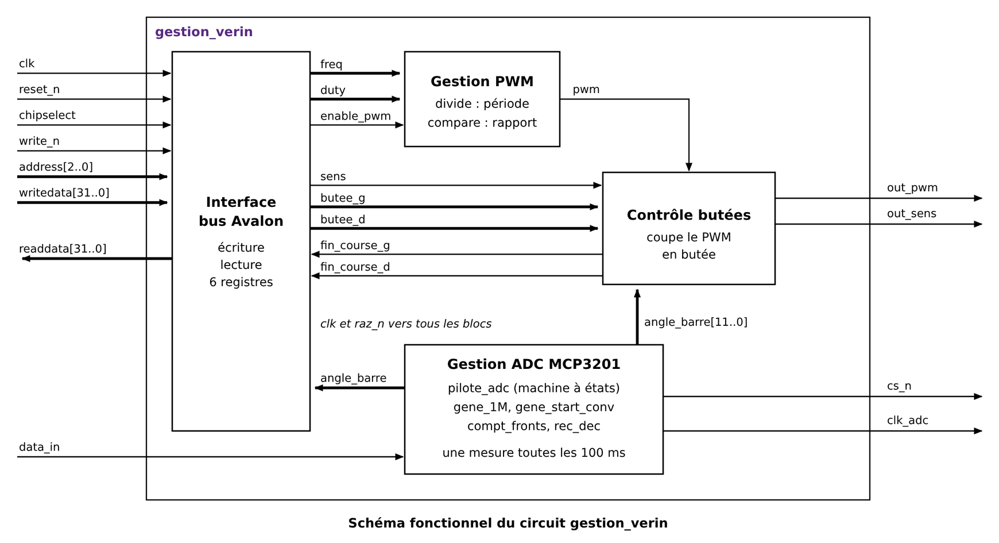

# Fonction complexe : gestion du vérin — analyse fonctionnelle

D'après la spécification des interfaces du pilote de barre franche (T. Perisse) et la carte
d'interface vérin.

## Rôle

Le circuit commande le vérin électrique qui déplace la barre. Il produit le PWM et le sens du
moteur, envoyés au pont en H DRV8835 de la carte d'interface. Il coupe le moteur quand la
barre atteint une butée, et lit la position de la barre (`angle_barre`) sur le convertisseur
MCP3201. Le Nios le pilote par 6 registres Avalon.

## Découpage

Comme conseillé, `gestion_verin` est découpé en **3 process**, chacun vérifié en simulation :

1. **Gestion du PWM** : fabrique le signal `pwm` à partir de `freq` et `duty` ;
2. **Contrôle des butées** : coupe le PWM quand la barre est en butée ;
3. **Gestion de l'ADC MCP3201** : lit `angle_barre` toutes les 100 ms.

Comme pour l'anémomètre, l'interface Avalon est dans un composant enveloppe,
`avalon_gestion_verin`, avec un process d'écriture et un de lecture. C'est lui qui présente au
Nios les ports du symbole de la spécification.

## Entrées / sorties

Composant complet `avalon_gestion_verin` (symbole de la spécification) :

| Signal | Sens | Rôle |
|---|---|---|
| `clk` | entrée | horloge 50 MHz |
| `reset_n` | entrée | reset du bus, actif à 0 |
| `chipselect`, `write_n`, `address[2..0]`, `writedata[31..0]` | entrées | bus Avalon |
| `data_in` | entrée | sortie série du MCP3201 |
| `readdata[31..0]` | sortie | bus Avalon |
| `out_pwm` | sortie | PWM du moteur, coupé en butée |
| `out_sens` | sortie | sens de rotation (0 = gauche) |
| `cs_n` | sortie | sélection du MCP3201, active à 0 |
| `clk_adc` | sortie | horloge série du MCP3201 |

Cœur `gestion_verin` (les 3 process, sans le bus) :

| Signal | Sens | Rôle |
|---|---|---|
| `clk`, `raz_n` | entrées | horloge 50 MHz, remise à zéro active à 0 |
| `freq[15..0]`, `duty[15..0]` | entrées | période et durée à l'état haut du PWM, en coups d'horloge |
| `enable_pwm` | entrée | 1 = PWM actif |
| `sens` | entrée | sens demandé (0 = gauche) |
| `butee_g[11..0]`, `butee_d[11..0]` | entrées | limites gauche et droite de `angle_barre` |
| `data_in` | entrée | sortie série du MCP3201 |
| `out_pwm`, `out_sens` | sorties | commande du pont en H |
| `cs_n`, `clk_adc` | sorties | commande du MCP3201 |
| `angle_barre[11..0]` | sortie | position de la barre |
| `fin_course_g`, `fin_course_d` | sorties | 1 quand la butée correspondante est atteinte |

## Registres

| Registre | Adresse | Type | Bits |
|---|---|---|---|
| `freq` | 0 | R/W | b15..b0 : période du PWM, f = 50 MHz / `freq` (2000 → 25 kHz) |
| `duty` | 1 (4) | R/W | b15..b0 : durée à l'état haut (`freq`/2 → 50 %) |
| `butee_g` | 2 (8) | R/W | b15..b0 : butée gauche, 0 à 4095 |
| `butee_d` | 3 (12) | R/W | b15..b0 : butée droite, 0 à 4095 |
| `config` | 4 (16) | R/W | b0 `raz_n`, b1 `enable_pwm`, b2 `sens` |
| | | R | b3 `fin_course_d`, b4 `fin_course_g` |
| `angle_barre` | 5 (20) | R | b11..b0 : position de la barre |

La remise à zéro du cœur est active si le bus est en reset ou si le bit `raz_n` de `config`
vaut 0, comme pour les composants du SOPC.

## Les 3 process

**1. Gestion du PWM** (reprend le PWM validé dans le SOPC)
- `divide` : `compteur` va de 0 à `freq` − 1 puis repart à 0, ce qui fixe la période ;
- `compare` : `pwm` vaut 1 tant que `compteur` est inférieur à `duty`.
Si `enable_pwm` = 0, le compteur reste à 0 et `pwm` à 0.

**2. Contrôle des butées** (`controle_butees`)
- `fin_course_g` = 1 si `angle_barre` ≤ `butee_g`, `fin_course_d` = 1 si `angle_barre` ≥
  `butee_d`. La gauche correspond aux petites valeurs, comme dans l'exemple du prof
  (`butee_g` = 410, `butee_d` = 1320) ;
- `out_pwm` = 0 si le moteur va vers une butée atteinte (`sens` = 0 et `fin_course_g` = 1, ou
  `sens` = 1 et `fin_course_d` = 1), sinon `out_pwm` = `pwm`. Le moteur peut toujours repartir
  dans l'autre sens ;
- `out_sens` = `sens`.

Les butées valent 0 au démarrage : tant que le Nios ne les a pas écrites, `fin_course_d` = 1
et le moteur ne peut pas aller à droite.

**3. Gestion de l'ADC MCP3201** : regroupe les 5 fonctions secondaires de la spécification
- `gene_1M` : divise 50 MHz par 50, donne un top `top_1M` à 1 MHz qui cadence la machine à
  états ;
- `gene_start_conv` : donne un top `start_conv` toutes les 100 ms, soit 10 mesures de l'angle
  par seconde ;
- `pilote_adc` : machine à états qui baisse `cs_n`, fabrique `clk_adc`, puis remonte `cs_n` et
  mémorise `angle_barre` ;
- `compt_fronts` : compte les fronts montants de `clk_adc` pour savoir quand la lecture est
  finie ;
- `rec_dec` : registre à décalage qui récupère `data_in` à chaque front montant de `clk_adc`.

## Signaux internes

| Signal | Process | Rôle |
|---|---|---|
| `compteur` | 1 | position dans la période du PWM, de 0 à `freq` − 1 |
| `pwm` | 1 → 2 | PWM avant le contrôle des butées |
| `fin_g`, `fin_d` | 2 | butée gauche / droite atteinte, sortis sur `fin_course_g`, `fin_course_d` (relus par le Nios dans `config`) |
| `moteur` | 2 | PWM après le contrôle des butées, sorti sur `out_pwm` |
| `cpt_1M`, `top_1M` | 3 | division de 50 MHz ; `top_1M` vaut 1 un coup d'horloge par µs |
| `cpt_100ms`, `start_conv` | 3 | division à 100 ms ; `start_conv` lance une lecture |
| `ep` | 3 | état de `pilote_adc` : `repos`, `lecture`, `fin` |
| `horloge` | 3 | horloge série fabriquée par `pilote_adc`, sortie sur `clk_adc` |
| `nb_fronts` | 3 | nombre de fronts montants de `clk_adc` depuis la baisse de `cs_n` (0 à 15) |
| `registre` | 3 | registre à décalage de 12 bits (`rec_dec`) |
| `angle` | 3 → 2 | dernière position lue, sortie sur `angle_barre` et gardée jusqu'à la lecture suivante |

## Échange avec le MCP3201

D'après la documentation du MCP3201 : la conversion démarre quand `cs_n` passe à 0. Le
convertisseur change sa sortie sur les fronts descendants de `clk_adc` ; on la lit sur les
fronts montants. L'horloge ne doit pas dépasser 1,6 MHz (alimentation 5 V).

| Front montant de `clk_adc` | `data_in` |
|---|---|
| 1 et 2 | rien d'utile : le MCP3201 échantillonne l'entrée analogique |
| 3 | bit nul (0) |
| 4 à 15 | B11 (poids fort) … B0 |

`registre` fait 12 bits : au 15ᵉ front montant, les 3 premiers bits reçus (échantillonnage et
bit nul) sont sortis par le décalage, et il contient B11…B0.

`data_in` est lu au moment où le FPGA fait monter `clk_adc`, soit 1 µs après que le MCP3201
l'a changé : il est stable, il n'a donc pas besoin d'être synchronisé comme l'entrée de
l'anémomètre.

Choix : `pilote_adc` inverse `clk_adc` à chaque `top_1M`, donc `clk_adc` = 500 kHz. Une lecture
dure 15 × 2 µs = 30 µs, très court devant les 100 ms entre deux mesures.

Machine à états de `pilote_adc` (écrite dans le process 3 avec les autres fonctions de l'ADC,
pour garder 3 process) :

| État | `cs_n` | `clk_adc` | Rôle | Passe à |
|---|---|---|---|---|
| `repos` | 1 | 0 | attend `start_conv` | `lecture` si `start_conv` = 1 |
| `lecture` | 0 | inversée à chaque `top_1M` | 15 fronts montants, `rec_dec` décale `data_in` | `fin` quand `nb_fronts` = 15 |
| `fin` | 1 | 0 | `angle_barre` ← 12 derniers bits de `registre` | `repos` |

## Code

| Fichier | Contenu |
|---|---|
| `gestion_verin.vhd` | cœur : process 1 (séquentiel, PWM), process 2 (combinatoire, butées), process 3 (séquentiel, ADC) |
| `avalon_gestion_verin.vhd` | enveloppe Avalon : process d'écriture, process de lecture, cœur instancié |
| `tb_gestion_verin.vht` | testbench du cœur, avec un modèle du MCP3201 |
| `tb_avalon_gestion_verin.vht` | testbench de l'enveloppe : écriture et relecture des registres |
| `sim_gestion_verin.do`, `sim_avalon_gestion_verin.do` | scripts ModelSim : compilation, signaux affichés, durée simulée |

Les génériques `max_1M` = 50 et `max_100ms` = 100 000 (en µs) donnent les vraies durées ; les
testbenches simulent donc 100 ms entre deux conversions.

## Validation en simulation

Le modèle du MCP3201 du testbench attend que `cs_n` passe à 0, laisse passer deux fronts
descendants de `clk_adc`, sort le bit nul puis les 12 bits de `valeur_adc`, poids fort en
premier, chacun sur un front descendant.

**Cœur `gestion_verin`** (`tb_gestion_verin.vht`, 305 ms simulées) :

| Temps | Action | Résultat |
|---|---|---|
| 0 ms | PWM 25 kHz (`freq` = 2000) à 50 % (`duty` = 1000), sens droite, butées 410 et 1320, le MCP3201 renvoie 800 | `out_pwm` actif ; `angle_barre` vaut 0 au démarrage, donc `fin_course_g` = 1, sans effet puisqu'on va à droite |
| 0,2 ms | `duty` = 500 | rapport cyclique 25 % |
| 0,4 ms | `enable_pwm` = 0 puis 1 | `out_pwm` bloqué à 0, puis de nouveau actif |
| 100 ms | première conversion | `angle_barre` = 800, `fin_course_g` = 0, `fin_course_d` = 0 |
| 110 ms | le MCP3201 renvoie 1500, au-delà de la butée droite | à 200 ms : `angle_barre` = 1500, `fin_course_d` = 1, `out_pwm` bloqué à 0 |
| 201 ms | sens gauche | `out_pwm` de nouveau actif : le moteur peut s'éloigner de la butée |
| 212 ms | le MCP3201 renvoie 300, en deçà de la butée gauche | à 300 ms : `angle_barre` = 300, `fin_course_g` = 1, `out_pwm` bloqué à 0 |
| 301 ms | sens droite | `out_pwm` de nouveau actif |

Chacun des 3 process est ainsi vérifié : le PWM (rapport cyclique et `enable_pwm`), les
butées (coupure seulement vers la butée atteinte) et l'ADC (les trois valeurs 800, 1500 et
300 sont relues exactement).

**Enveloppe `avalon_gestion_verin`** (`tb_avalon_gestion_verin.vht`, 101 ms simulées) :

- écriture des valeurs du programme d'exemple de la spécification : `freq` = 2000, `duty` =
  1500, `butee_g` = 410, `butee_d` = 1320, `config` = 1 (circuit actif, PWM coupé) ;
- relecture : 2000, 1500, 410, 1320, `config` = 17 et `angle_barre` = 0. 17 = 1 + 16 : le
  bit 4 (`fin_course_g`) est à 1 parce qu'aucune conversion n'a encore eu lieu ;
- `config` = 7 : `out_pwm` actif, `out_sens` = 1 ;
- après la première conversion : `config` = 7 (plus de fin de course) et `angle_barre` = 800.

Étapes suivantes : intégration dans le SOPC, puis essai sur la carte avec un vrai MCP3201 et
l'analyseur logique Signal Tap de Quartus.
